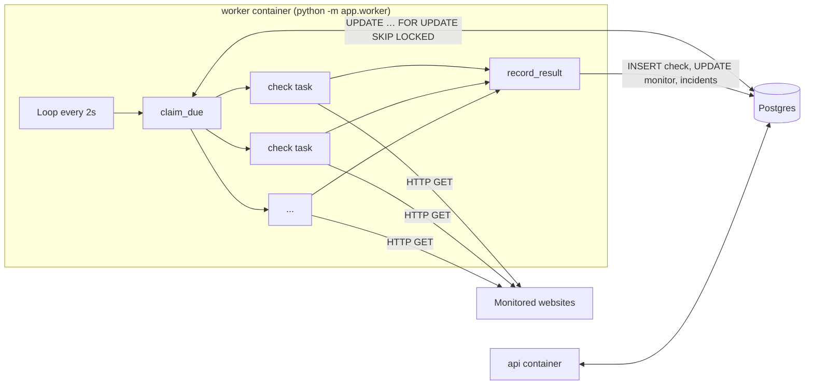
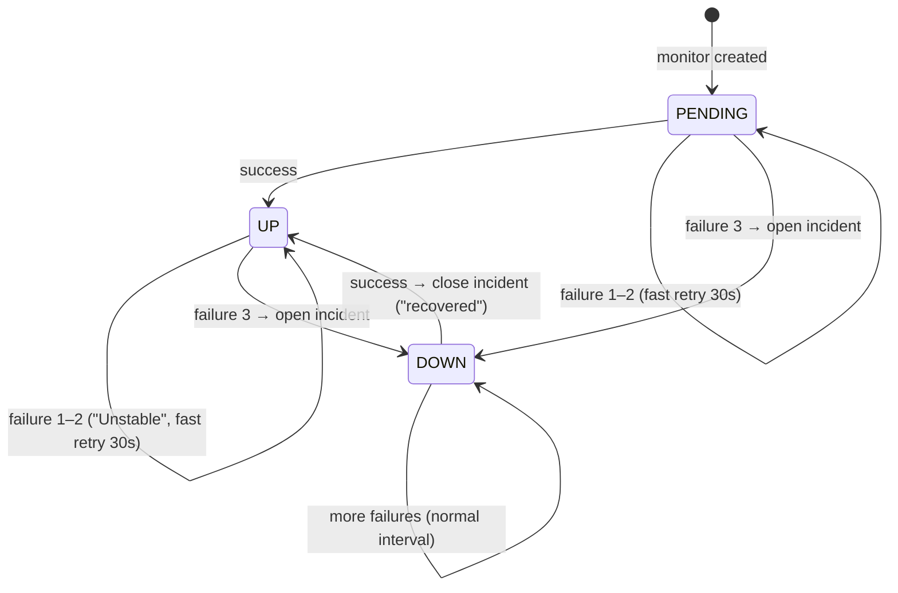

# How the Worker Checks Websites

This document explains the background worker: how it decides **when** to check a site, **how** it checks it, and how it decides whether the site is **up or down**. Every value below comes from the actual code. File references point to `backend/app/`.

---

## 1. Summary

The worker is a separate Python process in its own Docker container. It runs a loop every 2 seconds:

1. **Claim** monitors whose `next_check_at` has passed. Only as many as there are free slots, up to 20 at once.
2. **Check** each one with an HTTP `GET` (using `httpx`). Every address is checked against SSRF rules, and there is a 10-second time limit.
3. **Record** the result in Postgres and update the monitor's state. A site is only marked **DOWN after 3 consecutive failures**, to avoid false alarms. Then the next check is scheduled.

The API and the worker never call each other. They communicate **only through the database**.



---

## 2. Where it runs

| | |
|---|---|
| Container | `worker` in `docker-compose.yml` |
| Image | The same `uptime-monitor-backend` image as the API. The only difference is the command. |
| Command | `python -m app.worker` |
| Starts after | The API is healthy, which guarantees the database migrations have run |
| Health check | A heartbeat file, `/tmp/worker-heartbeat`. The container is unhealthy if the file hasn't been touched for 30 s. |

**Why a separate process?** A check can take up to 10 seconds. If checks ran inside the API, slow websites could slow down the dashboard. Separate processes keep them isolated, and the worker could be scaled on its own.

---

## 3. Files

| File | Responsibility | Touches the DB? | Touches the network? |
|---|---|---|---|
| `worker/main.py` | Process entry: wait for the DB, the main loop, heartbeat, shutdown on SIGTERM | only a `SELECT 1` at startup | no |
| `worker/scheduler.py` | `Worker` class: how many checks to start, running them as tasks, hourly retention | through `store` | through `checker` |
| `worker/store.py` | `claim_due()` and `record_result()`: all worker SQL | **yes** | no |
| `worker/checker.py` | `perform_check(url)`: one HTTP check, returns a `CheckResult` | no | **yes** |
| `worker/state.py` | `apply_result()`: the up/down rules. A **pure function**, with no I/O. | no | no |
| `worker/retention.py` | Deletes checks older than 30 days | yes | no |
| `services/url_safety.py` | SSRF protection, shared with the API | no | DNS only |

Splitting it this way means each part can be tested on its own. The up/down rules are tested without a database or network, and the HTTP checker is tested with mocked HTTP.

---

## 4. The main loop (`worker/main.py`)

```
start
  └─ wait_for_db()             retry "SELECT 1" every 2 s until Postgres answers
  └─ create one shared httpx client
  └─ loop until SIGTERM:
        worker.tick()          claim due monitors, start their checks (returns immediately)
        touch heartbeat file   proves the loop is alive (Docker health check)
        sleep 2 s              but wake up instantly if a stop is requested
  └─ shutdown:
        wait up to 15 s for in-flight checks to finish, then cancel the rest
        close the HTTP client and DB connections
```

Two safety rules:
- **An error in one iteration never kills the worker.** `tick()` is wrapped in `try/except`. The error is logged and the loop continues.
- **The loop never waits for checks to finish.** Each check runs as its own `asyncio` task. Even if 20 sites are slow, the loop keeps ticking and the heartbeat stays fresh.

---

## 5. Scheduling: deciding *when* to check

Every monitor row has a `next_check_at` timestamp. A monitor is **due** when `next_check_at <= now()` and it isn't paused.

### Claiming due monitors (`store.claim_due`)

This is one atomic SQL statement:

```sql
UPDATE monitors
SET    next_check_at = now() + interval_seconds          -- the "lease"
WHERE  id IN (
    SELECT id FROM monitors
    WHERE  NOT is_paused AND next_check_at <= now()
    ORDER  BY next_check_at                               -- most overdue first
    LIMIT  :free_slots
    FOR UPDATE SKIP LOCKED                                -- never grab a row another worker holds
)
RETURNING id, url, interval_seconds;
```

What each part does:
- **`FOR UPDATE SKIP LOCKED`**: if two workers run at the same time, they can never claim the same monitor. Each skips the rows the other has locked. One worker is the default, but scaling to more is safe.
- **The lease** (`next_check_at = now() + interval`): the monitor is pushed into the future as soon as it's claimed. If the worker crashes mid-check, the monitor isn't re-checked in a tight loop. It simply comes due again after its interval. When the check finishes, the real next time overwrites the lease.
- **`ORDER BY next_check_at`**: the most overdue monitors go first.
- A partial index, `ix_monitors_due ON monitors (next_check_at) WHERE NOT is_paused`, keeps this query fast.

### Concurrency: "claim only free slots" (`scheduler.Worker.tick`)

```
free_slots = WORKER_CONCURRENCY (20) − checks currently running
if free_slots > 0:
    claim up to min(free_slots, 100) monitors
    start one asyncio task per monitor
```

The worker never has more than 20 checks running, and it never leases monitors it can't start yet. (An `asyncio.Semaphore` would also limit concurrency, but monitors would sit claimed while waiting for a slot. See DECISIONS D16.)

---

## 6. Checking a site: the tools (`worker/checker.py`)

### Tools used

| Tool | Used for |
|---|---|
| **`httpx`** (async HTTP client) | Sending the `GET` request. Chosen because it's async, which allows many checks concurrently in one process. It has fine-grained timeouts, it lets us follow redirects ourselves, and it supports streaming, so the body is never downloaded. |
| **`asyncio.timeout`** (Python standard library) | One **total** 10-second deadline for the whole check, including DNS and every redirect hop |
| **`loop.getaddrinfo`** (Python standard library) | Resolves the hostname to IP addresses before connecting, for the SSRF check |
| **`ipaddress`** (Python standard library) | Decides whether an IP is public (`is_global`) or private, loopback, link-local and so on |
| **`time.perf_counter`** | Measures the response time precisely |
| **`ssl`, `socket`** exceptions | Identify SSL and DNS failures when classifying errors |

### The HTTP client settings (`build_http_client`)

```python
httpx.AsyncClient(
    follow_redirects=False,          # we follow redirects ourselves (see below)
    timeout=httpx.Timeout(10),
    headers={"User-Agent": "UptimeMonitor/1.0"},
    limits=httpx.Limits(max_connections=20, max_keepalive_connections=0),  # no keep-alive
    trust_env=False,                 # ignore proxy environment variables
)
```

- **No keep-alive:** every check opens a fresh connection. Response times stay comparable from one check to the next, because a reused connection would skip the TCP and TLS handshake and look faster. It also guarantees connection problems are actually detected.
- **`User-Agent`:** the site's owner can see in their logs who is checking them.

### Step by step: one check

```
perform_check(url):
  start the 10 s total deadline
  current = url
  repeat up to 6 times (1 request + max 5 redirects):
      1. scheme must be http/https           else → blocked_address
      2. resolve DNS, every IP must be public → else blocked_address (or dns if lookup fails)
      3. GET current URL (streamed: only headers are read, body never downloaded)
      4. add the time to response headers to the total response time
      5. if the response is a redirect (301/302/303/307/308 + Location header):
             current = Location (resolved against the current URL, e.g. "/login")
             continue
         else:
             return the final status code
  more than 5 redirects → too_many_redirects
```

**Why follow redirects manually?** Security. A public website could redirect to `http://169.254.169.254/` (cloud metadata) or `http://localhost:5432`. Validating each hop before requesting it means the worker never sends a request to an internal address. The test suite confirms the internal URL is never requested.

**Response time** = time from sending the request until the **response headers** arrive, added up over all redirect hops. The page body is never downloaded, so a large page doesn't distort the number and no bandwidth is wasted.

### The UP/DOWN rule for one check

| Final result | One check is… | `error_type` |
|---|---|---|
| HTTP **200–399** | ✅ **up** | none |
| HTTP **400–499** | ❌ down | `http_4xx` |
| HTTP **500+** | ❌ down | `http_5xx` |
| No response within 10 s | ❌ down | `timeout` |
| Hostname doesn't exist | ❌ down | `dns` |
| Certificate expired, self-signed or wrong host | ❌ down | `ssl` |
| Connection refused or reset | ❌ down | `connection` |
| More than 5 redirects | ❌ down | `too_many_redirects` |
| Resolves or redirects to a private address | ❌ down | `blocked_address` |
| Anything unexpected | ❌ down | `unknown` |

`perform_check` **never raises an exception**. Every failure becomes a classified `CheckResult` with a readable message (e.g. `"SSL error: certificate has expired"`), truncated to 500 characters.

**How errors are classified:** `httpx` wraps the low-level error, so the code walks the exception chain (`__cause__` / `__context__`). If it finds an `ssl.SSLError`, the error is `ssl`. A `socket.gaierror` means `dns`. Anything else is `connection`.

These real results were measured from the container:

```
https://expired.badssl.com/        → ssl   "SSL error: certificate has expired"
https://self-signed.badssl.com/    → ssl   "SSL error: self-signed certificate"
https://wrong.host.badssl.com/     → ssl   "Hostname mismatch, certificate is not valid for …"
http://github.com                  → up    200 (after redirect to https)
https://httpbin.org/status/503     → down  http_5xx  "HTTP 503"
https://this-site-does-not-exist.invalid → down dns
https://10.255.255.1/              → down  blocked_address
```

---

## 7. Recording the result (`store.record_result`)

All of this happens in **one database transaction**:

1. **Lock the monitor row** (`SELECT … FOR UPDATE`), so an API edit can't interleave.
2. **Discard stale results.** While the check was running, the user may have deleted the monitor, paused it, or changed its URL. In that case the result describes something that no longer applies, so it's thrown away and the API's reset is preserved (DECISIONS D18).
3. **Insert a row into `checks`**: time, up/down, status code, response time, error type and message.
4. **Apply the state machine** (next section) to get the new status, failure count and next check time.
5. **Update the monitor row**: status, `consecutive_failures`, `failing_since`, `last_*` fields (for the dashboard) and `next_check_at`.
6. **Open or close an incident** if the state machine says so.
7. **Commit.**

---

## 8. Deciding UP or DOWN for the monitor (`worker/state.py`)

One failed check doesn't mean the site is down. Networks have blips. The monitor's **confirmed** status follows these rules:

| Situation | What happens |
|---|---|
| Check succeeds | Status becomes **UP**. Failure count resets to 0. If it was DOWN, the incident is closed (**recovered**). |
| Failure 1 or 2 | Status stays as it was. The UI shows **"Unstable"**. The next check comes after **30 s** instead of the normal interval, to confirm quickly. |
| Failure 3 (`FAILURE_THRESHOLD`) | Status becomes **DOWN**. An incident opens. |
| More failures while DOWN | Stays DOWN. Checks continue at the **normal interval**. |



### Why the 30-second fast retry?
Without it, a monitor with a 5-minute interval would need 3 × 5 = **15 minutes** to confirm an outage. With the fast retry it takes **about 1 minute**, whatever the interval. The rule is `next check = now + min(interval, 30 s)`, so it never slows down a 30-second monitor.

### Why the incident starts at the *first* failure
The site was really down from the first failed check. Confirmation just came later. So `incident.started_at = failing_since`, the time of the first failure in the streak, and the outage duration is accurate.

### A real example (from the live test)

The "DNS failure demo" monitor (30 s interval):

```
17:25:33  check → dns error   failures = 1   status PENDING ("Unstable")   failing_since = 17:25:33
17:26:03  check → dns error   failures = 2   status PENDING ("Unstable")   (fast retry, 30 s)
17:26:34  check → dns error   failures = 3   status DOWN  → incident opened, started_at = 17:25:33
          log: WARNING Monitor 4 is DOWN: https://this-site-does-not-exist.invalid
```

The "HTTP 503 demo" (60 s interval) was confirmed DOWN in about 1 minute instead of 3, thanks to the fast retry.

---

## 9. Incidents

An **incident** is one outage: `started_at`, `resolved_at` (null while it's ongoing), and the cause (`error_type` and message).

- **Opened** when a monitor becomes DOWN.
- **Closed** when the first successful check arrives (`resolved_at` = that check's time).
- **Also closed** when the user pauses the monitor or changes its URL. Downtime shouldn't keep counting while nobody is checking (DECISIONS D15).
- The database guarantees **at most one open incident per monitor** with a partial unique index: `(monitor_id) WHERE resolved_at IS NULL`.
- Incidents are **never deleted** by retention. They're the long-term history.

---

## 10. Retention (`worker/retention.py`)

- Runs **at worker startup, then every hour**, as a background task. It never takes one of the 20 check slots.
- Deletes `checks` older than **`RETENTION_DAYS` (30)** in **batches of 5,000 rows**, so no single transaction locks the table for long.
- Keeps incidents.
- At a 30 s interval, one monitor produces about 2,880 checks per day, so retention keeps the table bounded.

---

## 11. Reliability features

| Problem | How it's handled |
|---|---|
| Worker crashes mid-check | The lease (`next_check_at` pushed forward at claim time) prevents a re-check storm. The monitor is simply checked after its interval. |
| Database briefly down | `wait_for_db()` at startup. During operation the failing iteration is logged and the loop continues. `pool_pre_ping` replaces dead connections. |
| Loop stuck | The heartbeat file goes stale, and Docker reports the worker unhealthy. |
| `docker compose stop` | SIGTERM sets a stop flag, in-flight checks get up to 15 s to finish, then the process exits cleanly (it measured at about 0.2 s when idle). |
| Two worker replicas | `FOR UPDATE SKIP LOCKED` ensures no monitor is checked twice at the same time. |
| User edits a monitor during a check | The row lock plus the stale-result discard (section 7). |
| A site redirects to an internal address | Every hop is validated, so the request is never sent (`blocked_address`). |
| A huge page | The body is never downloaded. Only headers are read. |

---

## 12. Configuration (`.env`)

| Variable | Default | Meaning |
|---|---|---|
| `CHECK_TIMEOUT_SECONDS` | 10 | Total time limit for one check, DNS and redirects included |
| `WORKER_CONCURRENCY` | 20 | Maximum checks running at the same time |
| `WORKER_POLL_SECONDS` | 2 | How often the loop looks for due monitors |
| `FAILURE_THRESHOLD` | 3 | Consecutive failures before DOWN |
| `RETRY_INTERVAL_SECONDS` | 30 | Fast re-check delay while a failure is unconfirmed |
| `MAX_REDIRECTS` | 5 | Redirect hops followed before `too_many_redirects` |
| `RETENTION_DAYS` | 30 | Age after which checks are deleted |

All values are validated at startup. For example, `WORKER_CONCURRENCY=0` stops the worker with a clear error instead of misbehaving.

---

## 13. Known limitations (documented trade-offs)

- **DNS rebinding window:** between our DNS check and httpx's own connection there's a tiny window where DNS could change. Checking every hop reduces the risk. Pinning the connection to the validated IP would remove it entirely (future hardening, D5).
- **Recovery speed while DOWN:** a DOWN monitor is re-checked at its normal interval, so recovery is noticed within one interval (D4).
- **Uptime is check-weighted:** the fast-retry checks slightly over-weight failure periods in the uptime % (D8).
- **4xx counts as down:** a page that intentionally returns 401/403 shows as down. Per-monitor expected status codes are future work (D3).

---

## 14. Watching it work

```bash
# Live worker log: DOWN (WARNING) and RECOVERED (INFO) events
docker compose logs -f worker

# Latest checks
docker compose exec db psql -U uptime -c \
  "SELECT monitor_id, checked_at, is_up, status_code, response_time_ms, error_type FROM checks ORDER BY checked_at DESC LIMIT 10;"

# Incidents
docker compose exec db psql -U uptime -c "SELECT * FROM incidents ORDER BY started_at DESC;"
```

For one log line per check, set `LOG_LEVEL=DEBUG` in `.env` and restart the worker.

## 15. Tests covering the worker

| Test file | What it proves |
|---|---|
| `tests/test_state.py` | Every up/down transition, the fast retry, incident start = first failure |
| `tests/test_checker.py` | Each error type, redirects (relative, loop, to a private IP, to another scheme), the total deadline, the User-Agent |
| `tests/test_worker_store.py` | Claiming only due and unpaused monitors, the lease, 3 failures → incident → recovery, stale results discarded |
| `tests/test_scheduler.py` | Claims only free slots, never blocks on slow checks, shutdown drains or cancels, retention doesn't take a slot |
| `tests/test_retention.py` | Batched deletion of old checks only; incidents kept |
| `tests/test_worker_loop.py` | Heartbeat, surviving a failing iteration, prompt stop |

Run them with `docker compose run --rm api pytest`.
